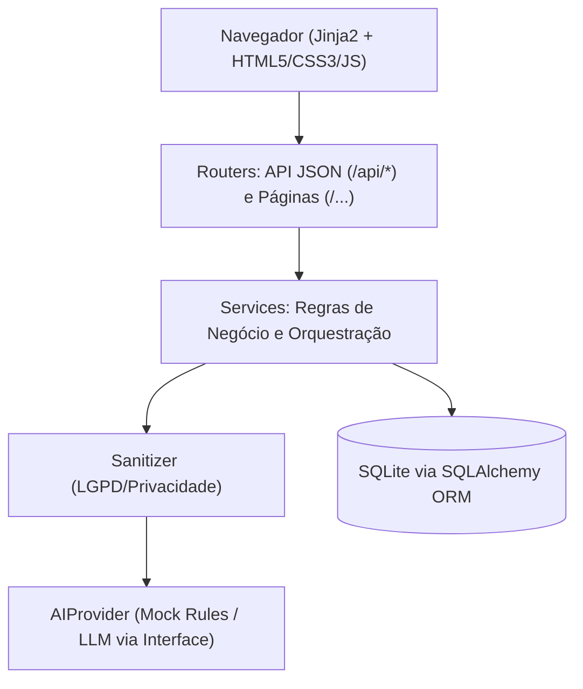
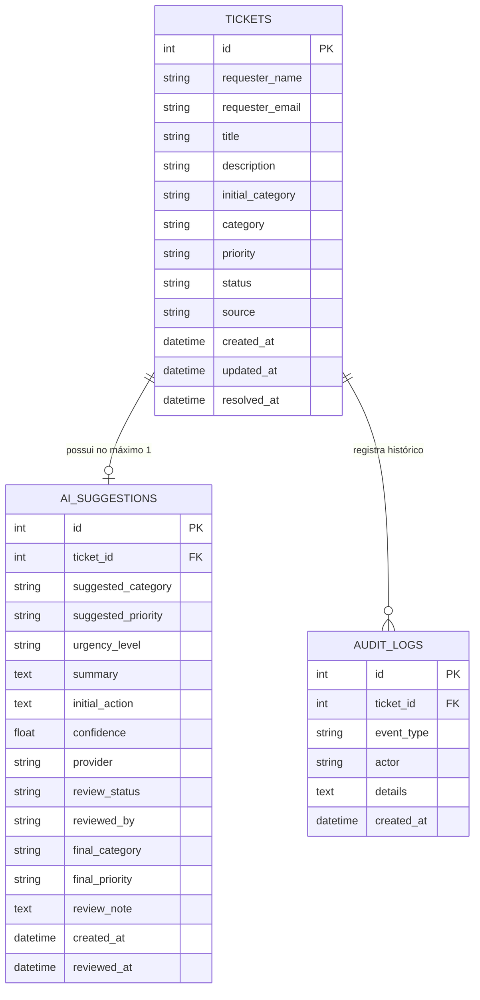
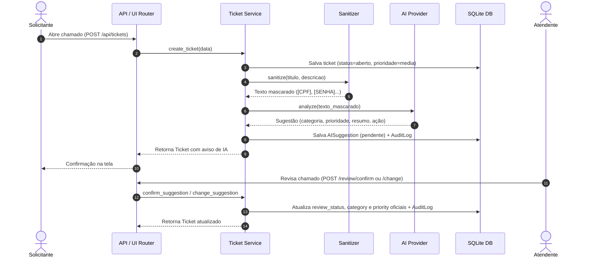

# Arquitetura do HelpDesk IA

## Visão Geral do Sistema

O HelpDesk IA adota uma arquitetura em camadas orientada a serviços com separação clara de responsabilidades:

## Regras de Responsabilidade por Camada

- **Routers (`app/routers/`):** Recebem requisições HTTP, realizam injeção de dependências (`Depends(get_db)`, `Depends(get_ai_provider)`), delegam para a camada de serviços e devolvem respostas com tipagem serializada (Pydantic / HTML). Nunca executam consultas SQL diretamente.
- **Services (`app/services/`):** Contêm todas as regras de negócio, transações do banco de dados, chamadas ao sanitizer e orquestração de IA. Desconhecem detalhes de transporte HTTP ou renderização HTML, permitindo testes unitários limpos.
- **Models (`app/models/`):** Descrevem as tabelas e relacionamentos do banco de dados relacional via SQLAlchemy 2.0 Declarative Base.
- **Schemas (`app/schemas/`):** Descrevem os contratos de validação de entrada e serialização de saída da API via Pydantic v2.
- **AIProvider (`app/services/ai/base.py`):** Interface abstrata desacoplada. O sistema interage exclusivamente com a interface `AIProvider`. A substituição do mock por um LLM real requer apenas adicionar o novo provider e alterar a variável `AI_PROVIDER` no `.env`.

## Modelo de Dados (DER)

### Decisão Crítica de Modelagem:
Manter `suggested_*` (categoria e prioridade propostas pela IA) e `final_*` (decisão oficial do atendente humano) em colunas separadas é fundamental para a viabilidade do projeto: se a decisão humana sobrescrevesse a sugestão original, seria impossível calcular retrospectivamente a acurácia do modelo e as matrizes de confusão.

## Fluxo Completo de um Chamado

## Decisões Técnicas e Trade-offs

| Decisão | Alternativa Avaliada | Justificativa |
|---|---|---|
| **SQLite** | PostgreSQL | Zero fricção para rodar localmente e avaliar no GitHub. O uso de SQLAlchemy permite migrar para PostgreSQL em produção mudando apenas a connection string. |
| **Páginas Jinja2** | SPA (React/Vue) | Elimina a necessidade de ambiente Node.js, `npm install` e build steps. Foca 100% no domínio de backend, dados e IA para o portfólio. |
| **Sanitizer pré-IA** | Enviar texto bruto | Garante o princípio de minimização de dados da LGPD e prepara o código para quando um LLM externo for conectado. |
| **Provider Mock** | API OpenAI direta | Testes determinísticos, execução offline sem custo de tokens e reprodutibilidade garantida para qualquer recrutador avaliando o projeto. |
